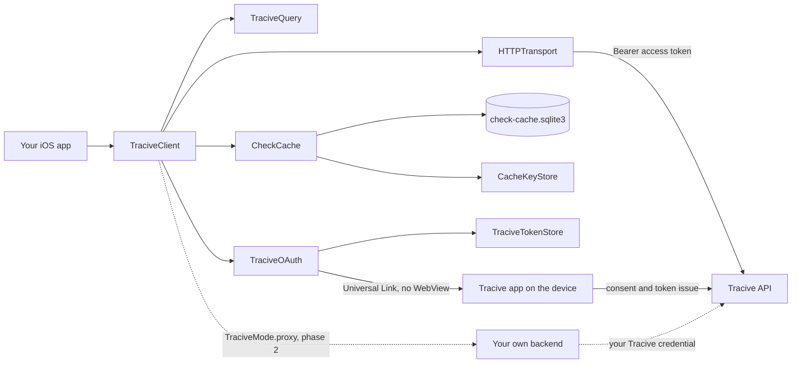
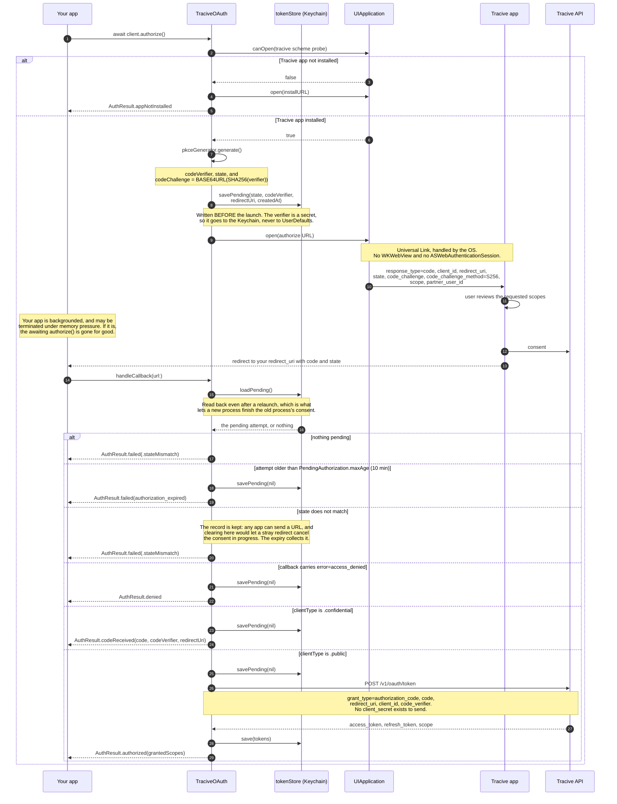
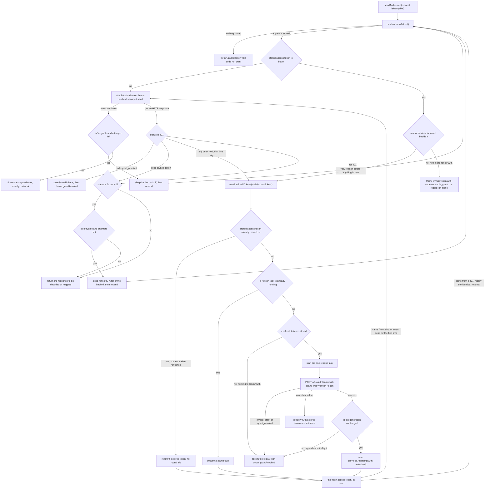
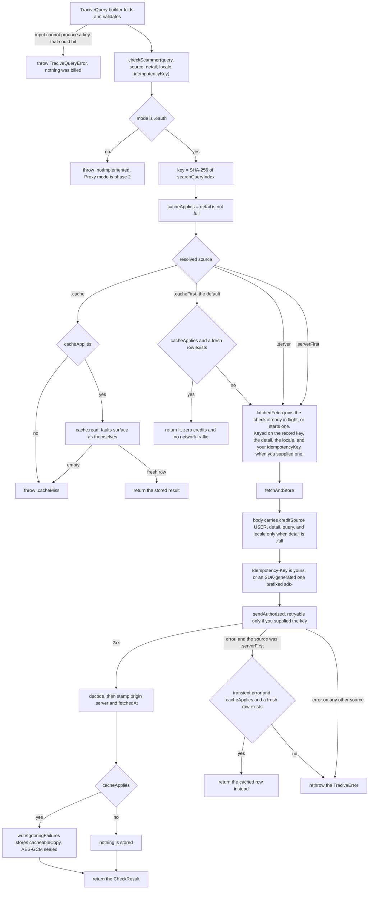
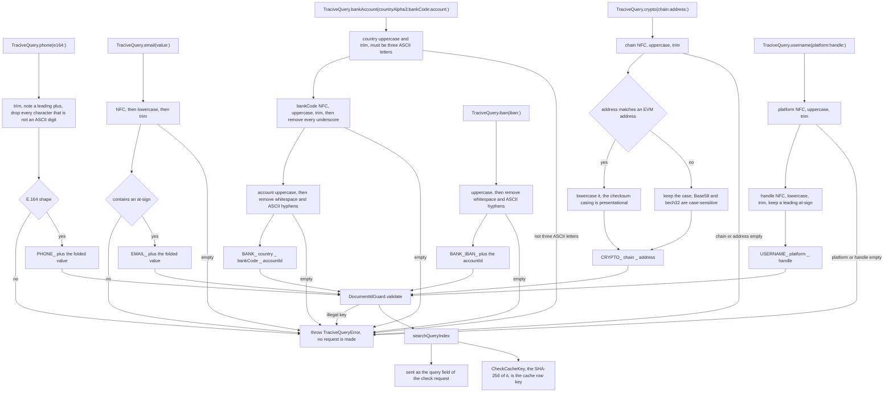

# Architecture

What the SDK is made of, and how a call travels through it.

This page is for someone who has never seen this package before and wants the shape of it in five
minutes. Everything drawn here is taken from the types in `Sources/TraciveSDK/`; where a diagram
simplifies, the prose under it says what it left out.

> **Status.** phase 1 is OAuth mode only. The diagrams describe what the code does, which is
> written against the contract and exercised against an injected fake transport. See the README for
> what that means for your integration plan.

| | |
|---|---|
| [Where the SDK sits](#1-where-the-sdk-sits) | the pieces, and what talks to what |
| [Consent: OAuth with PKCE](#2-consent-oauth-with-pkce) | the app-to-app handoff, step by step |
| [Token lifecycle](#3-token-lifecycle) | expiry, single-flight refresh, reuse detection |
| [A check, end to end](#4-a-check-end-to-end) | validation, cache, network, cache write |
| [Folding an identifier](#5-folding-an-identifier-into-a-lookup-key) | the query grammar |

---

## 1. Where the SDK sits

`TraciveClient` is the only type most integrations touch. It is an `actor` that owns four
collaborators: the query builder that validates and folds an identifier, the encrypted local cache,
the OAuth driver, and the HTTP transport. Every byte of network traffic leaves through
`HTTPTransport`, which is a protocol — that seam is why the whole SDK is testable without a server.

Reading the boxes:

- **`TraciveQuery`** turns a raw identifier into a validated, folded `searchQueryIndex`. It runs
  before anything else and never touches the network — see [section 5](#5-folding-an-identifier-into-a-lookup-key).
- **`CheckCache`** is a protocol. `SQLiteCheckCache` is the production conformer: the system
  `libsqlite3` for storage, an AES-GCM sealed payload per row, and the data key held by a
  `CacheKeyStore` in the Keychain. `NoOpCheckCache` stands in when caching is disabled, so the
  client can call the cache unconditionally instead of threading an optional through every path.
- **`TraciveOAuth`** is a second `actor`. It drives consent, holds the PKCE material for the attempt
  currently waiting on a callback, and owns the single-flight refresh. Tokens live in a
  `TraciveTokenStore` — `KeychainTokenStore` by default.
- **`HTTPTransport`** is the injectable seam. `URLSessionHTTPTransport` is the default; it returns
  the response for **every** HTTP status and throws only when there was no response at all.

The dotted path is `TraciveMode.proxy`, which is phase 2. The type is already in the public surface
so that enabling it later is not a source-breaking change, but every call made in that mode throws
`TraciveError.notImplemented` today. `Docs/proxy-contract.md` describes the gateway contract it will
use.

There is **no API-key parameter in either mode**, deliberately and permanently. In OAuth mode the app
carries a short-lived user-scoped access token; in Proxy mode it carries whatever headers your own
backend expects, and your server is what holds a Tracive credential.

---

## 2. Consent: OAuth with PKCE

`authorize()` is one `await` at the call site, but it crosses a process boundary in the middle: the
authorize URL is opened as a Universal Link that the Tracive app claims, and the flow resumes when
your `AppDelegate`/`SceneDelegate` forwards the redirect to `handleCallback(url:)`. Your app is
backgrounded for the whole of the user's visit to Tracive and may not survive it, which is why the
attempt is written to the token store before the launch rather than kept in a field.

Seven things the diagram is making visible on purpose:

1. **The install pre-check happens before any redirect.** If `canOpen` says no, the SDK opens the
   clean install link — which carries no OAuth parameter of any kind — and answers
   `.appNotInstalled`. The flow never starts, so no consent parameter is handed to a third party.
   Your app must list the scheme under `LSApplicationQueriesSchemes`, or `canOpenURL` returns
   `false` for every user. There is no deferred resume: the user installs Tracive, comes back, and
   taps again.
2. **No WebView, anywhere.** The authorize URL is opened with `UIApplication.open`. Universal Links
   do not fire from inside an in-app web view, so the flow would simply never complete — and
   RFC 8252 forbids an embedded user agent for OAuth regardless.
3. **PKCE is S256 only.** `PKCE.codeChallengeMethod` is the constant `"S256"`; `plain` is never
   sent. With `plain` the challenge *is* the verifier, so anyone who can read the authorize URL can
   complete the exchange.
4. **`state` is checked first, before the callback's `error` parameter is even read.** A callback
   whose state does not match is not ours, and reading its contents would mean acting on an
   attacker-supplied URL. The comparison is constant-time.
5. **A confidential client stops at the code.** The exchange needs a `client_secret`, and a mobile
   binary has nowhere to keep one, so the SDK hands the code, the verifier and the redirect URI back
   for your own backend to exchange. Nothing is stored locally on that path.
6. **The attempt is persisted before the launch, and read back after it.** That ordering is the
   whole mechanism: the app can only be killed once it is in the background, which is after the
   `open`, so a record written afterwards would not exist during the one window that matters. On
   the way back the store is consulted whenever this process has no attempt of its own — which is
   exactly the post-termination case — so a relaunched app completes a consent it never started.
   Because there is no `authorize()` left to resume then, `handleCallback(url:)`'s **return value**
   is the only place that outcome appears.
7. **The record is erased on every outcome that spends or abandons it**, so a spent callback cannot
   be replayed by a later process, and a `signOut()` cannot leave a live verifier behind. A `state`
   mismatch is the deliberate exception, for the reason the diagram notes: erasing there would let
   any app on the device cancel a consent in progress by sending one URL.
8. **A URL that is not this client's redirect is refused before any of that runs**, and answers
   `nil` rather than an `AuthResult`. Hosts are told to route every deep link through
   `handleCallback(url:)`, so "not mine" has to be an answer the method can give — otherwise a
   foreign URL reaches the `state` comparison, fails it, and resumes the suspended `authorize()`,
   which is the same one-`open` cancellation that rule 7 exists to prevent, arriving one step
   earlier.

Two details omitted from the diagram to keep it readable. `authorize()` installs its continuation
*before* it asks the OS to open the URL, so a callback that arrives during the launch cannot strand
the caller — note that the pending record is written earlier still, inside `makeAuthorizationRequest()`,
with no suspension between the two, so neither can overtake the other; and a `signOut()` that lands
while the code exchange is in flight wins — the exchange sees the token generation has moved and
refuses to store the grant it just obtained.

---

## 3. Token lifecycle

The SDK does **not** refresh pre-emptively on a locally computed expiry. Refresh is driven by the
server answering **401**, because the server's clock is the one that decides; refreshing off a
device clock that has drifted forward would burn a refresh-token rotation for nothing — and each
surplus rotation is another chance to present a retired token to reuse detection.

Note what this means for the diagram below: there is no expiry decision anywhere in it. The stored
token is sent whatever `expiresAt` says, including on the first request of a session where it has
already passed. `TraciveTokens.isExpired(at:)` exists for a host app that wants to read the expiry
itself; no path here calls it.

The one thing the SDK does decide locally is whether the stored access token is **blank**, and that
is not an expiry judgement — a blank token is not a token at all. See
[below](#a-blank-access-token-is-refreshed-before-anything-is-sent) for why the server cannot be
left to answer that one.

### A blank access token is refreshed before anything is sent

A stored grant can hold a blank access token beside a perfectly good refresh token.
`TraciveTokens.accessToken` is a plain `String`, so a record whose `access_token` is `""` decodes as
cleanly as any other — a partial write, a Keychain save interrupted by a termination, or a restored
backup will all produce one.

**Blank means whitespace-only as well as empty.** `Authorization: Bearer    ` is exactly as unusable
as `Bearer `, and a rule written as "empty" waves it straight through — `"   ".isEmpty` is `false`.
Kotlin has always tested blankness here, and this SDK now matches it, on the refresh token beside it
as well as on the access token.

Two things could be done with such a record, and both are wrong. Sending it puts `Bearer ` on the
wire. Discarding it throws away the refresh token, which *is* the grant and is still live. So the
SDK refreshes: the grant is renewed before the first request leaves, and the caller never learns
anything was wrong.

The reactive 401 path cannot do this job, which is why the check is on the client side. An empty
bearer is not an expired token, it is a malformed one — the server answers `invalid_token`, and this
SDK treats `invalid_token` as terminal: no refresh is attempted and the grant is discarded. A
damaged record left to the server therefore never heals. It fails permanently, spending a round trip
each time to be told something that was knowable before the send.

The renewal goes through the same `refreshTokens(…)` as the 401 path rather than a private one, so
it inherits the single-flight guarantee below: a blank token discovered while a refresh is already
running joins that refresh instead of racing it.

With no refresh token beside it — absent, or stored blank — there is nothing to renew
with, and `accessToken()` answers that case itself instead of delegating: `.invalidToken` with the
code `unusable_grant`, nothing sent, and the record left as it was found. It is terminal in the same
way the `no_grant` guard is, and it stays terminal in the same way on every later call, because
nothing erased what the report was about.

The diagram used to route this case into `refreshTokens(…)` and out through the node that clears the
store and throws `.grantRevoked`, and that was a false statement about the server rather than merely
an odd one. `.grantRevoked` means the server revoked the grant; here nothing was sent and nothing
was rejected. A partner alerting on revocation — a sensible alert, since revocation is how reuse
detection surfaces — was paged by a damaged file on one device.

Every edge still reaching that node follows something that really happened to the grant: a
`401 grant_revoked` on a request, an `invalid_grant`/`grant_revoked` answer to the refresh, a
refresh started by a token the server had already rejected and left with nothing to renew from, and
a refresh whose result is abandoned because `signOut()` dropped the grant while it was in flight.

### Single-flight, and why it is not an optimisation

Tracive's refresh tokens **rotate**: every refresh returns a new one and the old one dies. Two
concurrent refreshes would present the same old token twice, and the second presentation is
indistinguishable from a stolen-token replay — the correct server response to which is to revoke the
whole grant. Users would be signed out at random, in bursts, under load.

`TraciveOAuth` guarantees one refresh two ways, and the diagram shows both:

- **The cheap half.** If the stored access token no longer equals the stale one that produced the
  401, some other caller already refreshed; the fresh token is returned with no round trip at all.
- **The real half.** `refreshTask` is a single stored `Task`. Because `TraciveOAuth` is an actor and
  the check-and-set has no suspension point between reading and writing it, a second caller racing
  with the *same* stale token either finds the task and awaits its result, or is the one that
  creates it. Never both.

### Reuse detection, and the two paths to `.grantRevoked`

A `401 grant_revoked` on any request, and an `invalid_grant`/`grant_revoked` on the refresh itself,
both mean the same thing: the grant is gone, usually because the server's reuse detection fired.
Stored tokens are cleared and `TraciveError.grantRevoked` is thrown. **Do not retry it** — send the
user back through consent.

The `tokenGeneration` check is the third way a refresh ends without storing anything. It is bumped by
`signOut()` and `clearStoredTokens()`, and it is re-read immediately before the write, on the actor.
A refresh whose round trip was already in flight when the user signed out therefore abandons its
result rather than writing a freshly rotated refresh token onto a device the user believes is signed
out. Task cancellation is not a substitute: cancellation in Swift is cooperative, and a response
already on the wire arrives whatever the task's cancellation state.

### Replay versus retry

They are different budgets. The replay after a successful refresh re-sends the identical request and
does **not** consume a retry attempt — it is a re-authentication, not a retry of a failed check. Only
one refresh is attempted per request; a second 401 falls through and surfaces.

The retry loop, by contrast, is governed by `RetryPolicy` and by `isRetryable`, which is `true` for
`GET /v1/credits` and `GET /v1/profile` — no side effects, so nothing to double-charge — and for a
check **only when you supplied an `Idempotency-Key`**. A check without your key fails fast on the
first 5xx or timeout rather than risking a second charge. A `Retry-After` header, when the server
sends one, wins over the computed backoff.

---

## 4. A check, end to end

Validation is first and local; the cache is next; the network is last. The order is a cost control,
not just hygiene — a miss is billed exactly like a hit, so a key that could never hit is a credit
spent on nothing.

`latchedFetch` sits in front of the request for the same reason. Two checks for the same record key,
detail and locale — a double-tapped button, or the same number appearing twice in a list — collapse
into one request and one bill. Your own `idempotencyKey` is part of the latch key, so two callers who
deliberately keyed themselves apart stay apart; a caller who passes no key changes nothing. The store
happens inside the flight, so a collapsed check is written once.

### What is not cached, and why

**One flag, `cacheApplies`, gates three things**: the cache read, the cache write, and the
`.serverFirst` fallback. It is `detail != .full`, decided once in `checkScammer` and passed down, so
the read side and the write side of the rule cannot drift apart. Each of the three is wrong for
`.full` for its own reason:

- **The read is wrong because of `detail`.** A stored row never contains `comments` or
  `topChronologies`, so serving one to a `.full` caller returns them as `nil` — byte-identical to
  "the server answered in full and there are no incidents on file". A screen rendering "no incident
  reports" from that is showing a wrong fraud answer, not a stale one, and it is silent: nothing
  throws, nothing logs, no request leaves the device.
- **The write is wrong because of `locale`.** The stored projection keeps `tags` and `disclaimer`,
  which are localized, and the row key is the query alone with no locale in it. Only a `.full`
  request sends a `locale`. Storing its projection would file locale-specific text under a
  locale-less key, and the next `.minimal` check — which sends no locale — would read it straight
  back. `disclaimer` is the one string every integrator is asked to put on screen.
- **The fallback is wrong because there is no stale version of narrative content**, only a missing
  one that renders as an empty one. `.minimal` trades freshness for an answer quite reasonably; a
  `.full` request that fails on the network surfaces the failure and lets you decide.

The practical consequences: a `.full` request is never free, never warms the cache for a later
`.minimal` one, and fails rather than degrading when offline.

Two narrower exclusions apply even to a `.minimal` response that *is* stored.
`CheckResult.cacheableCopy()` drops `topChronologies`, `comments`, `billing` and `checkId` before the
payload is sealed — `billing` because a cache hit costs nothing and replaying a stored charge would
report money that was never spent, and `checkId` because it names one specific server-side check and
a cache hit is not one. And a store whose `CachePolicy.isEnabled` is `false` accepts no rows at all.

### The `.serverFirst` fallback is narrower than "the call failed"

It requires `error.isTransient` — network, 429, or 5xx. A 402 or a 403 is a real answer about your
account, and quietly serving a cached verdict instead would hide a billing or permission problem
until it became someone else's incident.

### What the cache stores

| Column | Contents | Readable without the data key |
|---|---|---|
| `key` | SHA-256 of `searchQueryIndex`, hex | yes — a digest, never the identifier |
| `payload` | AES-GCM sealed box of the cacheable `CheckResult` as JSON | no |
| `fetched_at` | when the server produced the data | yes |
| `expires_at` | prune hint, as of write time | yes |
| `written_at` | when this row was written | yes |

The raw phone number, email, IBAN or crypto address is never written to disk in any column. Freshness
is decided on **read**, from the current policy applied to the decoded row, so a policy change takes
effect immediately and a row that went stale while the app was backgrounded is never served;
`expires_at` is only an index for the prune pass. Storage format, TTLs, key derivation and the threat
model are in [`caching.md`](caching.md).

---

## 5. Folding an identifier into a lookup key

Every builder normalises its input into `searchQueryIndex` — the canonical string the server keys on
and, hashed, the local cache key. The folding rules are pinned by
`Tests/TraciveSDKTests/Fixtures/query-grammar-vectors.json`, which is vendored byte-identically into
the sibling SDKs and run as a test in each, so a fold that drifts in one language fails its own build
instead of quietly building keys that miss.

### The rules the diagram compresses

- **Whitespace is JavaScript's, not Foundation's.** The server folds in JavaScript, so byte-identical
  output means reimplementing JavaScript's semantics. `QueryFolding.javaScriptWhitespace` is
  ECMAScript's `WhiteSpace ∪ LineTerminator` set, transcribed from the fixture and asserted against
  it. It includes U+FEFF, which Foundation's `.whitespacesAndNewlines` does not strip, and excludes
  U+200B, which Foundation does strip. Digits are ASCII-only for the same reason: JavaScript's `\D`
  is exactly `[^0-9]`, so the server strips Arabic-Indic digits rather than converting them.
- **The order inside each fold is load-bearing.** Email is NFC *then* lowercase *then* trim. The bank
  account id is uppercase *then* strip, and NFC is deliberately not applied to it, because the server
  does not apply it either.
- **Validation is only where a wrong key could never hit.** A phone number must be E.164 — the server
  cannot up-convert a local-format number, so `081234567891` would index as a different entity and
  the miss would still be billed. An email needs an at-sign and nothing more: the server performs no
  shape validation, so a stricter grammar here would reject addresses the server would have matched,
  and losing a real fraud answer costs more than one miss.
- **`DocumentIdGuard`** rejects a key that is empty, contains `/`, is `.` or `..`, exceeds 1500 UTF-8
  bytes, or matches the API's reserved `__…__` shape — matched with JavaScript's regex semantics,
  which accept a middle containing a line terminator.
- **There is no `domain()` builder.** The API indexes only PHONE, EMAIL, BANK, CRYPTO and USERNAME. A
  `DOMAIN_…` key would miss every time and you would be charged for every one of those misses.

The full grammar, including the exact rejection reasons, is in `TraciveQueryError` and in the fixture
itself. Do not "improve" a fold: the folded key is both the server's record key and the local cache
key, so a client-side deviation splits one entity into two.

---

## Where to go next

| | |
|---|---|
| [`integration.md`](integration.md) | wiring it into an app, end to end |
| [`oauth.md`](oauth.md) | the consent flow, PKCE, token refresh, sign-out |
| [`caching.md`](caching.md) | storage format, encryption, TTLs, threat model |
| [`proxy-contract.md`](proxy-contract.md) | phase 2 Proxy mode, for planning |
