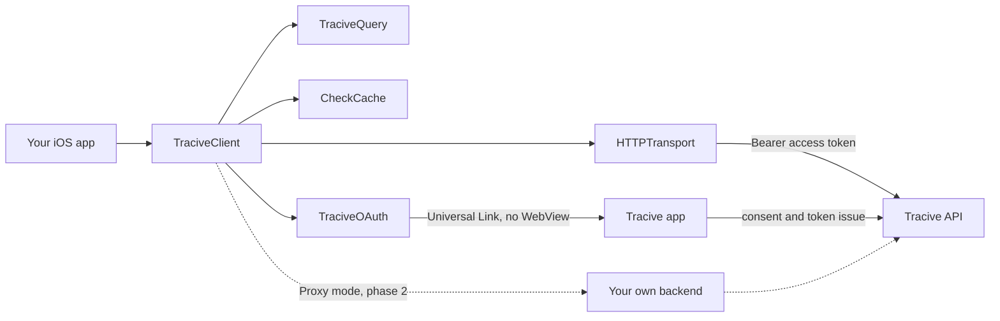

# Tracive SDK for Swift

Scammer lookup for iOS apps — check a phone number, email, bank account, IBAN, crypto address or
social handle against Tracive's community fraud index, with a local encrypted cache so the same
identifier is not billed twice.

**Version 0.1.0 · iOS 15+ / macOS 12+ · Apache-2.0**

---

## Read this before you plan an integration

Three facts, up front, because each of them changes what you can build this quarter.

### 1. The Tracive Open API is not live yet

There is no `api.tracive.id` answering requests today. This package is written against the frozen
contract, and it is complete and tested — but every test in it
runs against an **injected fake transport**, not a server. Nothing here has been exercised end to
end against a real deployment, and no test in this repository is allowed to require one.

You can integrate, compile, unit-test and ship the wiring now. You cannot get a real verdict yet.

### 2. phase 1 is OAuth mode only

`TraciveMode.oauth` is the whole of the supported surface. `TraciveMode.proxy` — routing checks
through the partner's own backend — is **phase 2**. The type exists today so that adding it later is
not a source-breaking change for you, but every call made in Proxy mode throws:

```
TraciveError.notImplemented("Proxy mode arrives in phase 2")
```

That is deliberate and documented, not an unfinished stub. See `Docs/proxy-contract.md` for the
shape it will take, so you can design around it now.

### 3. There is no API key. Anywhere. In either mode.

There is no `apiKey` parameter in any public type in this package, and there will not be one. A
mobile binary cannot keep a secret: an API key compiled into an app is a published credential, and
publishing a credential that spends money is how a fraud-check integration turns into someone else's
billing incident.

Instead:

- **OAuth mode** carries a short-lived, user-scoped access token obtained through the Tracive app.
- **Proxy mode** (phase 2) carries whatever headers *your* backend mints for *your* gateway. Your
  server holds any Tracive credential; the app never sees it.

If a design document, a ticket or a helpful autocomplete ever suggests adding a key parameter here,
that is the bug.

---

## Zero third-party dependencies, by design

`Package.swift` has **no `dependencies:` array**, and CI fails the build if a third-party
dependency is ever declared — in this package or in the Example.

This is a feature, not an accident of scope. When you add a fraud-check SDK you inherit its supply
chain: every transitive package is another maintainer who can ship code into your app, another
licence to clear, and another entry in your SBOM. Everything this SDK needs is already on the
device:

| Need | What it uses |
|---|---|
| HTTP | `URLSession` (Foundation) |
| JSON | `Codable` (Foundation) |
| SHA-256, AES-GCM, HKDF, P-256 | CryptoKit |
| Local storage | the system `libsqlite3` (`import SQLite3`) |
| Data-key storage | Security / Keychain, Secure Enclave-backed where available |

Notably there is **no SQLCipher**. The Swift cache encrypts each row's payload with AES-GCM instead
of encrypting the database file — same protection for the data that matters, no dependency. See
`Docs/caching.md` for why that trade is the right way round.

---

## Install

Swift Package Manager:

```swift
.package(url: "https://github.com/pleistocent/tracive-sdk-swift.git", from: "0.1.0")
```

then add `TraciveSDK` to your target's dependencies. In Xcode: **File → Add Package Dependencies…**

---

## Quick start

```swift
import TraciveSDK

let client = TraciveClient(
  mode: .oauth(
    clientId: "your-client-id",
    redirectUri: URL(string: "https://yourapp.example.com/oauth/tracive")!,
    scopes: [TraciveScopes.scammerCheck, TraciveScopes.creditsRead]
  ),
  environment: .production
)

// 1. Consent, once per user.
switch await client.authorize() {
case .authorized(let grantedScopes):
  break
case .appNotInstalled:
  // The SDK has already opened the install link — https://tracive.chottu.link/install,
  // carrying no OAuth parameters. Ask the user to come back and retry; there is no
  // deferred resume.
  return
case .denied:
  return
case .codeReceived(let code, let codeVerifier, let redirectUri):
  // Confidential clients only — forward these to your own backend.
  return
case .failed(let error):
  throw error
}

// 2. Build a query. Validation and folding happen here, before any network call.
let query = try TraciveQuery.phone(e164: "+6281234567891")

// 3. Check.
let result = try await client.checkScammer(query)

if result.found, result.riskTier == .high {
  showWarning(
    reports: result.reportTotal,
    tags: result.tags,
    disclaimer: result.disclaimer   // see "Surface the disclaimer" below
  )
}
```

A working, compiling SwiftUI example lives in [`Example/`](Example/) — it renders a result, honours
the disclaimer, and runs entirely offline against an injected checker, which is exactly how you
should unit-test your own integration.

### Scopes

`TraciveScopes` holds the wire strings. Use it instead of typing them:

| Constant | Wire value | Grants |
|---|---|---|
| `TraciveScopes.scammerCheck` | `scammer.check` | running a scammer check |
| `TraciveScopes.creditsRead` | `credits.read` | reading the user's remaining credits |
| `TraciveScopes.profileRead` | `profile.read` | reading the minimal user profile |

Ask for the narrowest set that works — every extra scope is one more permission on the consent
screen. And note where a mistyped scope surfaces: the authorization server is the only thing that
validates a scope name, and it rejects the **entire** consent request when it does not recognise
one. A typo is not a smaller grant, it is an integration that cannot authorize at all, and nothing
local will tell you.

---

## How it works

`TraciveClient` is the only type most integrations touch. It owns four collaborators: the query
builder that validates and folds an identifier before anything leaves the device, the encrypted
local cache, the OAuth driver, and the HTTP transport that every byte of traffic goes through.



Consent is an app-to-app handoff: the SDK checks that Tracive is installed, then opens the authorize
URL as a Universal Link that the Tracive app claims, and the redirect comes back to your app. A
check is validated locally, answered from the cache when it can be, and only then sent to the
server.

The full diagram set — the consent sequence, the single-flight token refresh, the cache routing
rules, and the folding grammar per identifier type — is in
**[`Docs/architecture.md`](Docs/architecture.md)**.

---

## Queries

Six builders. Each one folds the input into the canonical `searchQueryIndex` that the server keys
on, and each one throws `TraciveQueryError` if the input cannot produce a key that could ever hit.

```swift
try TraciveQuery.phone(e164: "+6281234567891")
try TraciveQuery.email(value: "budi@example.com")
try TraciveQuery.bankAccount(countryAlpha3: "IDN", bankCode: "BCA", account: "3242424242")
try TraciveQuery.iban(iban: "DE89 3704 0044 0532 0130 00")
try TraciveQuery.crypto(chain: "ETH", address: "0x52908400098527886e0f7030069857d2e4169ee7")
try TraciveQuery.username(platform: "INSTAGRAM", handle: "@scammerx")
```

**Validation is a cost control, not just hygiene.** A miss is billed the same as a hit, so a key that
cannot possibly hit — a local-format phone number, an alpha-2 country code, an empty account, a
value with no `@` passed to `email` — is a credit spent on nothing. The builders reject those
locally, before the request is made.

The email check is `@`-presence and nothing more. The server does not validate the shape of an
email, so `EMAIL_budi` is a legal key: it is looked up, it misses, and you are charged. But a
stricter address grammar here would be a downgrade, not an upgrade — rejecting an address the server
would have matched loses you a real fraud answer, which costs more than one miss. `budi@localhost`,
`budi@[192.168.0.1]` and `"budi something"@example.com` all build a key.

**There is no `domain()` builder.** The plan lists a DOMAIN input type; the backend never shipped it
and emits only PHONE / EMAIL / BANK / CRYPTO / USERNAME. A `DOMAIN_…` key would miss every time, and
you would be charged for every one of those misses.

The exact folding rules are pinned by `Tests/TraciveSDKTests/Fixtures/query-grammar-vectors.json`,
vendored verbatim into the Kotlin, Flutter and Swift SDKs. All three run it as a test, so a fold that
drifts in one language fails its own build rather than quietly building keys that miss.

---

## Caching

On by default. A cache hit costs **zero credits and does no network I/O**.

```swift
let result = try await client.checkScammer(query, source: .cacheFirst)  // default
result.origin  // .cache or .server
try client.cache.clear()
```

| Source | Behaviour with `detail: .minimal` (default) | Behaviour with `detail: .full` |
|---|---|---|
| `.cacheFirst` | fresh cache entry if there is one, otherwise the server (default) | always the server; the cache read is skipped |
| `.server` | always the server; the response still refreshes the cache | always the server; the response is **not** cached |
| `.serverFirst` | the server, falling back to the cache if the call fails | always the server; a failure is raised, not degraded |
| `.cache` | cache only; a miss throws `TraciveError.cacheMiss` rather than answering empty | always `TraciveError.cacheMiss`; still no network call |

### `detail: .full` does not use the cache at all — in either direction

**It is never read.** Full-detail content is never stored, so serving a stored row to a `.full`
caller would return `comments` and `topChronologies` as `nil` — indistinguishable from "the server
answered in full and there are no incidents on file". A screen rendering "no incident reports" from
that is showing a wrong fraud answer, not a stale one, so the SDK does not do it.

**It is never written either**, for a separate reason worth knowing before you file a bug about it.
The row key is the query alone, with no locale in it, and the stored projection keeps `tags` and
`disclaimer`. Only a `.full` request sends a `locale`. Storing one would file locale-specific text
under a locale-less key, and the next `.minimal` check — which sends no locale — would read it back
as if it were the default: a legal disclaimer rendered in a language the user never asked for.

What that means for you:

```swift
// `origin` is always `.server` here, so nil really does mean none on file.
let result = try await client.checkScammer(query, detail: .full)
render(result.comments ?? [])
```

Three consequences worth planning for. A `.full` request is never free — budget a round trip and a
credit for each one, and ask for `.minimal` when a risk tier is all you are going to render. A
`.full` request also does not warm the cache, so a `.full` check followed by a `.minimal` check on
the same query costs two credits, not one; if you want both, do the `.minimal` one first. And a
`.full` request offline fails rather than degrading: catch it and fall back to `.minimal` yourself
if a partial answer is better than none for your screen.

Default TTLs: `HIGH` 30 days, `ELEVATED` 7 days, `CAUTION` 24 hours, `NONE` 1 hour. A `NONE` verdict
is the one most likely to go stale — today's clean number is tomorrow's scammer — so it is held for
the shortest time.

What is stored: `SHA-256(searchQueryIndex)` as the row key, and an AES-GCM-sealed JSON payload. The
raw phone number, email or account number is **never** written to disk. Neither is full-detail
content (`topChronologies`, `comments`), nor `billing`, nor `checkId` — which is why the call-out
above routes `detail: .full` past the cache entirely.

Details, threat model and tuning: **[`Docs/caching.md`](Docs/caching.md)**.

---

## Things that will cost you money or trust if you get them wrong

### Do not call `credits()` before every check

```swift
// Wrong: two API calls per transaction, forever.
let credits = try await client.credits()
if credits.subscriptionCredits > 0 {
  let result = try await client.checkScammer(query)
}

// Right: one call, and let the server tell you.
do {
  let result = try await client.checkScammer(query)
} catch TraciveError.insufficientCredits(let which, _) {
  showTopUp(for: which)
}
```

A pre-flight balance check doubles your request volume and is *still* racy — the balance can change
between the two calls. Handle the 402 instead. `credits()` is for a settings screen, not a hot path.

### Do not retry a check without an `Idempotency-Key`

A `checkScammer` that failed on a 5xx or a timeout may well have been charged. Retrying it blind can
charge the user twice for one lookup. The SDK never auto-retries a check for exactly this reason. If
you retry, pass the same key both times:

```swift
let key = UUID().uuidString
let result = try await client.checkScammer(query, idempotencyKey: key)
// …a retry of *this* check reuses `key`, and the server collapses the duplicate.
```

The request always carries *some* `Idempotency-Key`: when you supply none, the SDK generates a
per-call one (prefixed `sdk-`). That exists so the SDK's own replay after a 401 token refresh can be
collapsed server-side — it is not a retry budget, and it cannot deduplicate across your own process
restarts. Supply your own key, derived from your transaction, whenever you intend to retry.

### Surface the disclaimer

`CheckResult.disclaimer` is not decoration. Tracive's data is community-submitted, and a UI that
presents it as a verdict of fact — rather than as reports from other users — misrepresents it and
exposes you and us. Show it wherever you show the result.

### Never complete the OAuth flow in a `WKWebView`

The SDK opens the authorize URL with `UIApplication.open` as a Universal Link. Do not route it
through an in-app web view: Universal Links do not fire from one, so the flow simply will not
complete — and RFC 8252 forbids it anyway, because an in-app web view can read the user's Tracive
credentials as they type them. See **[`Docs/oauth.md`](Docs/oauth.md)**.

---

## Errors

Everything throws `TraciveError`. The interesting cases:

| Case | Meaning | What to do |
|---|---|---|
| `.insufficientCredits(which:info:)` | 402 | prompt for a top-up |
| `.rateLimited(retryAfter:info:)` | 429 | back off by `retryAfter` |
| `.grantRevoked` | the whole grant is gone | tokens are already cleared; restart consent. **Do not retry** |
| `.expiredToken` | refresh failed | restart consent |
| `.missingScope` / `.detailNotPermitted` | 403 | your client is not entitled to that call |
| `.cacheMiss` | `.cache` source with nothing fresh stored — or with `detail: .full`, which no row can answer | go to the server |
| `.network(cause:)` | no HTTP response at all | offline; see the idempotency note above before retrying |
| `.notImplemented` | Proxy mode, today | use OAuth mode |

An error code this SDK does not recognise never crashes and is never swallowed: it arrives as
`.server` or `.unknown` still carrying the server's raw code, so a future-version code shipped after this
release still reaches you intact.

---

## Privacy

- The raw identifier is never persisted. Cache rows are keyed by `SHA-256(searchQueryIndex)`.
- Cached payloads are encrypted with AES-GCM under a key held in the Keychain, Secure Enclave-backed
  where the device has one, and marked `ThisDeviceOnly` so it never travels in a backup.
- Tokens live in the Keychain — never `UserDefaults`, never a plist, never a file.
- `TraciveQuery`, `CheckCacheKey`, `ProxyConfiguration` and `TraciveQueryError` all redact themselves
  in `description`, so a stray `print`, `os_log` interpolation or crash report cannot leak an
  identifier or a bearer token.
- **`signOut()` does not clear the cache.** It revokes the grant and drops the tokens; the encrypted
  store survives. Those rows are keyed by `SHA-256` of a phone number or an email address — a small
  enough search space to brute-force offline — so on a shared device the next user could confirm
  which identifiers the previous one checked. Call `try? client.cache.clear()` alongside `signOut()`
  whenever a device may be shared:

  ```swift
  await client.signOut()
  try? client.cache.clear()   // not implied by signOut(); see Docs/oauth.md
  ```

  The two are separate calls because they are separate decisions — an app where the device is
  single-user may reasonably keep a warm cache across a re-login, and clearing it costs real money
  in re-billed checks.

---

## Documentation

| | |
|---|---|
| [`Docs/architecture.md`](Docs/architecture.md) | the diagram set: components, consent, tokens, cache routing, folding |
| [`Docs/integration.md`](Docs/integration.md) | wiring it into an app, end to end |
| [`Docs/oauth.md`](Docs/oauth.md) | the consent flow, PKCE, token refresh, sign-out |
| [`Docs/caching.md`](Docs/caching.md) | storage format, encryption, TTLs, threat model |
| [`Docs/proxy-contract.md`](Docs/proxy-contract.md) | phase 2 Proxy mode, for planning |
| [`SECURITY.md`](SECURITY.md) | reporting a vulnerability |
| [`CHANGELOG.md`](CHANGELOG.md) | what changed |

---

## Development

```bash
swift build
swift test          # 100% offline: no network, no Keychain, no real server
```

The tests use `EphemeralCacheKeyStore` rather than the real Keychain, because a `swift test` binary
is unsigned and Keychain access from one either fails outright or prompts a human — and a test that
can prompt is a test that hangs CI.

That "100% offline" is **enforced, not just intended**: `OfflineGuaranteeTests` scans the test
sources and fails the build if any test constructs `URLSessionHTTPTransport` or the production
`KeychainCacheKeyStore()`, or calls `SQLiteCheckCache(…)` without a `keyStore:` or `TraciveClient(…)`
without a `cache:` — the two defaults that would otherwise reach the Keychain and Application
Support one omitted argument at a time.

`SQLiteCheckCache.schemaVersion` is the invalidation lever: bump it and every stored row is dropped
on the next launch. Do that whenever the payload shape or the encryption format changes.

---

## Versioning

SemVer, `0.x` until the API freezes. While the backend is still unreleased, minor versions may make
breaking changes; they will be listed in `CHANGELOG.md`.

## Licence

Apache-2.0. See [`LICENSE`](LICENSE).
